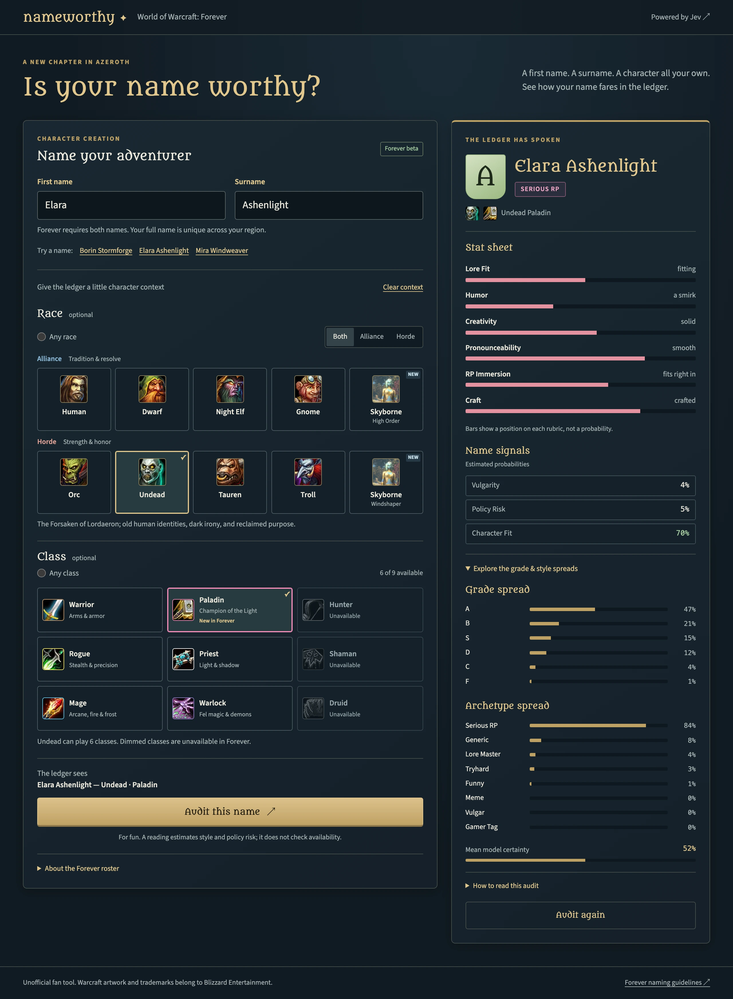

# nameworthy

A name auditor for **World of Warcraft: Forever**. Give your adventurer a first name and a
surname, optionally choose a race and class from the visual character picker, and read the
ledger's grade (S–F), naming style, six-stat sheet, and probability-based name signals.
All for fun.



## Why

Forever is Blizzard's realmless rework where every character carries a required two-part name,
unique across the region, and the two parts are judged *together* against the code of conduct
([Blizzard, "Create a Name of Your Own in WoW: Forever"](https://news.blizzard.com/en-us/article/24304161/create-a-name-of-your-own-in-wow-forever)).
People are already running the full spectrum — earnest RP, family surnames, memes, and names
that will not survive a report. The ledger ranks where a name lands.

## What you get

- A **grade** from S (unforgettable) to F (a crime against roleplay), with the full spread
  behind it — every grade's probability, not just the verdict.
- A **naming style** (archetype): Serious RP, Lore Master, Funny, Meme, and more, again with
  the complete distribution.
- A **six-stat sheet**: Lore Fit, Humor, Creativity, Pronounceability, RP Immersion, and
  Craft, each rated on a five-level rubric with a position bar.
- **Name signals**: estimated probabilities that the name reads as vulgar or would get
  reported and force-renamed under the naming policy — plus whether it fits your chosen
  race and class.
- A **character picker** with all nine Forever races and classes, including the new
  combinations and the faction-specific Skyborne options.

Nothing here checks name availability or decides Blizzard policy — it's a reading, for fun.

## The character picker

Forever is in beta, with global launch scheduled for **November 4, 2026**. The picker follows
the Forever roster, including its new combinations and faction-specific Skyborne choices
([Blizzard's race/class table](https://news.blizzard.com/en-us/article/24304075/create-the-hero-you-want-to-be-in-world-of-warcraft-forever),
[launch announcement](https://news.blizzard.com/en-us/article/24301508/pre-purchase-world-of-warcraft-forever-upgrades-and-begin-your-next-journey-in-azeroth)).

Race and class remain optional — selecting, filtering, and trying the built-in examples makes
no model calls.

---

# Technical details

## Character creation internals

- Nine races and nine classes, with **ten race options** because Skyborne choose a faction.
- New-combination badges for Human Hunter, Dwarf Shaman, Gnome Priest, Orc Mage,
  Undead Paladin, Troll Warlock, and Skyborne's classes.
- High Order Skyborne can be Mages; Windshapers can be Shaman. Both can be Warriors,
  Hunters, Rogues, and Druids. Skyborne require an upgrade pack in the game.
- Changing race preserves a compatible class or clears an incompatible one with an explanation.

`internal/character/catalog.go` is the single roster source: Go validates API input against it
and serializes the same catalog for Alpine. Invalid or non-Forever combinations fail before
the judge is called. Keyboard selection uses native radio groups.

## How the ranking works

One System One call (TypeSafe Jev, `jev-latest`) evaluates the name along many axes at once,
mapping each primitive to the capability it is best at:

| Jev primitive | Used for | Examples |
| --- | --- | --- |
| `score` (ordered legend) | the six ranked dimensions | Lore Fit, Humor, Creativity, Pronounceability, RP Immersion, Craft (`effort` in the API) |
| `noul` (probability) | flags | Vulgarity, Policy Risk (reportable / force-rename), Character Fit (when race/class given) |
| `choice` (distribution) | verdicts with spreads | Grade S–F, Archetype (8 styles) |

Scores are probability-weighted positions on five-level rubrics. The bar normalizes the
position to 0–1; the displayed level is the most likely legend entry. Grade and style honor
Jev's returned choice, including ties. “Mean model certainty” averages the six score and two
choice confidences; it is not an accuracy guarantee. Name signals show estimated yes-probabilities.
The ledger does not check name availability or determine Blizzard's policy decisions.

The client checks answer coverage, types, numeric ranges, complete distributions, and matching
score rubrics. A requested Character Fit answer is required. The whole evaluation has a
15-second deadline; 429/529 retries use bounded backoff and support both Retry-After formats.

## Run

```sh
mise install
mise run build
TYPESAFE_API_KEY=sk-… ./nameworthy -addr :8080   # or drop a .env next to the binary
# open http://localhost:8080
```

The binary embeds the page, CSS, and JS glue. `TYPESAFE_API_KEY` comes from the environment,
or a `.env` fallback in the working directory followed by the binary's directory. An explicitly
set environment variable always wins. Simple `export KEY=VALUE` lines and matching quoted
values are supported.

Without a key the page and `/health` still serve; a valid audit request returns 503 with a
configuration hint. This also lets CI smoke-test the app without credentials or model calls.

HTMX 4.0.0, Alpine.js 3.17.4, and Open Props 1.7.23 load from pinned CDNs with integrity hashes.
Metamorphous and Source Sans 3 load from Google Fonts. Warcraft icons load from Wowhead/ZAM;
the Skyborne portrait comes from the [Forever race guide](https://wowclassicforever.info/races/).
Text labels and initials survive artwork load failures; recovered images become visible again.

Every deliberate audit spends paid API tokens. The endpoint limits valid requests to ten per
minute per peer IP and sends `Retry-After` on 429. All audit buttons share request synchronization,
disable the form during evaluation, and validate the same required name fields.

## Docker

The multi-stage build produces a stripped, statically linked Linux executable with
`CGO_ENABLED=0`. The final **scratch** image contains that executable, its MIT license, and a
CA certificate bundle for HTTPS requests to TypeSafe. It runs as non-root UID/GID
`65532:65532` and supports a read-only root filesystem. The Go HTTP server serves the
embedded frontend directly.

```sh
docker build -t nameworthy .
docker run --rm --name nameworthy \
  -p 127.0.0.1:8080:8080 \
  --env-file .env \
  --read-only --cap-drop=ALL --security-opt=no-new-privileges \
  nameworthy
```

Open `http://localhost:8080`. The `.env` file supplies container environment variables at
runtime and is excluded from the build context. Use plain `KEY=VALUE` lines for Docker's
`--env-file` format. Alternatively, pass an exported key with `--env TYPESAFE_API_KEY`.
Omit `--env-file .env` to serve the page without a key; audits then return the configuration hint.

The image defaults to `-addr :8080`; arguments after the image name override that default.
`GET /health` is available for HTTP readiness checks (not `/healthz` — see the Cloud Run
notes below). Docker sends SIGTERM directly to the
Go process for graceful shutdown. Scratch has no shell or command-line HTTP probe tools.

The image builds with any Docker builder, including Cloud Build's classic builder: it uses
no BuildKit-only syntax. `TARGETOS`/`TARGETARCH` are optional — BuildKit fills them for
`--platform` builds; other builders leave them empty and Go builds for the native host.
Cross-architecture builds with Buildx run the compile stage under emulation, so build on
the target architecture when that is unavailable. `GO_VERSION` can be overridden with a
build argument when updating the pinned project toolchain.

## Google Cloud Run

The same container deploys to Cloud Run, which scales to zero when idle — an idle demo
costs nothing beyond the always-free allowance:

```sh
gcloud run deploy nameworthy \
  --source=. \
  --region=us-central1 \
  --allow-unauthenticated \
  --service-account=<PROJECT_NUMBER>-compute@developer.gserviceaccount.com \
  --set-secrets=TYPESAFE_API_KEY=typesafe-api-key:latest \
  --min-instances=0 --max-instances=2 --memory=256Mi --cpu=1 \
  --timeout=60s --concurrency=40
```

Prerequisites, one time per project:

```sh
gcloud projects create <GCP_PROJECT_ID> --name=nameworthy
gcloud billing projects link <GCP_PROJECT_ID> --billing-account=<BILLING_ACCOUNT_ID>
gcloud config set project <GCP_PROJECT_ID>
gcloud services enable run.googleapis.com cloudbuild.googleapis.com \
  artifactregistry.googleapis.com secretmanager.googleapis.com

# Store the key from a file or stdin — never a shell argument that echoes it.
gcloud secrets create typesafe-api-key --data-file=-
# Grant the runtime service account read access to the secret.
gcloud secrets add-iam-policy-binding typesafe-api-key \
  --member=serviceAccount:<PROJECT_NUMBER>-compute@developer.gserviceaccount.com \
  --role=roles/secretmanager.secretAccessor
```

- The health endpoint is `GET /health` — Cloud Run's Google Front End reserves paths
  ending in `z` (like `/healthz`, `/livez`, `/readyz`) and answers them with its own 404
  before the request reaches the container.
- Secret rotation: `:latest` is re-resolved only when a new revision is created. Rotate
  with `gcloud secrets versions add typesafe-api-key --data-file=-` followed by
  `gcloud run services update nameworthy --set-secrets=TYPESAFE_API_KEY=typesafe-api-key:latest`.

## Develop

```sh
mise run fmt     # gofmt -w .
mise run lint    # golangci-lint
mise run test    # go test -race ./...
mise run build   # single binary with embedded frontend assets
```

CI (GitHub Actions + mise) runs the same gates plus native and read-only container smoke
boots on every push and PR. Container smoke checks use no API credentials or model calls.

## API

`POST /api/audit` with form fields or JSON `{"first_name":…,"last_name":…,"race":…,"class":…}`;
append `?format=json` or send `Accept: application/json` for the envelope. The response echoes the
inputs and carries the verdict: `grade`/`grade_dist`, `archetype`/`archetype_dist`, `dims`
(top level, normalized 0–1 score, and raw level-line position per dimension), `flags`
(yes-probability per flag), `confidence`, plus `model`, `usage`, and `latency_ms` provenance.
First name and surname are both required. Each is trimmed and limited to **24 Unicode code
points** by the API, a tool bound rather than a claim about in-game naming limits. Overlong
names are rejected rather than shortened. Request bodies are limited to 16 KiB.

Race and class use the names displayed in the picker, with case-insensitive API matching.
For Skyborne, use `Skyborne (High Order)` or `Skyborne (Windshaper)` to identify the faction.
For example:

```json
{"first_name":"Mira","last_name":"Windweaver","race":"Skyborne (Windshaper)","class":"Shaman"}
```

JSON callers receive `{"error":"…"}` on errors as well as JSON on success:

| Status | Meaning |
| --- | --- |
| 400 | Missing or overlong names, invalid context, or malformed JSON/form |
| 413 | Body exceeds the input bound |
| 415 | Unsupported request content type |
| 429 | Local rate limit; inspect `Retry-After` |
| 502 | Upstream failure or invalid model response |
| 503 | TypeSafe API key is not configured |
| 504 | Evaluation deadline exceeded |

`GET /health` returns `ok`; unknown page paths return 404.

## Notes

- Unofficial fan tool. Not affiliated with Blizzard Entertainment. Warcraft artwork and
  trademarks belong to Blizzard Entertainment; original application code is [MIT-licensed](LICENSE).
